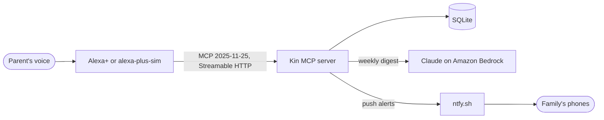

# Kin

Kin is an Alexa+ companion for parents who live alone. It is a self-hosted MCP server that lets an older parent simply talk: log their medicines, do a daily check-in, ask Kin to remember appointments and ask about them later. Kin watches for patterns the family should know about (missed medicines, a falling mood, the same question asked again and again) and pushes alerts and a weekly digest to their children's phones.

Built for the **Alexa+ track** of the Build, Ship, Shape: Amazon Developer Hackathon, with entries in the **AWS Builder** and **Open Source** mini challenges.

- **MCP spec:** 2025-11-25 over Streamable HTTP (the server also answers 2026-07-28 clients from the same endpoint)
- **MCP Apps:** `get_today` renders a smart-display card (`ui://kin/today.html`)
- **Elicitation:** medicine orders ask the parent "Are you sure?" before anything is placed
- **AWS:** Claude on Amazon Bedrock writes the weekly family digest
- **Companion project:** [alexa-plus-sim](https://github.com/AlgoMasterArpit/alexa-plus-sim), an open-source voice and screen simulator for Alexa+ MCP servers, used in the demo

## Why

Millions of parents live alone while their children work in other cities. The children worry about missed medicines, about mood and about early signs of memory decline, and today's caretaking apps expect the parent to use a smartphone. Kin moves that work into a conversation the parent already knows how to have, and keeps the family informed without the parent filling in a single form.

## What Kin can do

| Tool               | What it does                                                                                                  |
| ------------------ | ------------------------------------------------------------------------------------------------------------- |
| `get_today`        | Today's medicines with status, unconfirmed doses to ask about, reminders and the check-in. Renders the card.  |
| `log_medication`   | Records a dose as taken or skipped, by name, nickname ("BP tablet") or purpose, for today or earlier days.    |
| `daily_checkin`    | Saves mood, sleep, appetite and a note from a gentle conversation.                                            |
| `remember`         | Saves something to remember, optionally tied to a date.                                                       |
| `recall`           | Answers "when is my doctor appointment?" from saved memories and logs the question.                           |
| `notice_patterns`  | Finds skipped and long-unconfirmed doses, falling mood, poor sleep, missing check-ins and repeated questions. |
| `alert_family`     | Pushes a notification to the family through ntfy, with duplicate suppression and an audit trail.              |
| `reorder_medicine` | Orders a refill after an elicitation prompt. Orders are simulated: no payment is taken and nothing ships.     |
| `family_digest`    | Writes the weekly family update with Claude on Bedrock (template fallback) and can send it to the family.     |

The server also ships voice instructions for the Alexa+ agent: start with `get_today`, keep replies short and spoken, never give medical advice, and send an urgent alert and point to emergency services when the parent reports a fall, chest pain or trouble breathing.

Kin does not wait for the parent to speak. A background **watchdog** checks every 15 minutes, alerts the family once a day about urgent concerns, and sends an evening summary at 21:30.

## Kin asks before it worries

The hardest case for any caretaking app: Mom takes her 9 PM tablet but forgets to tell anyone. A naive app marks it "missed", tells her son, and after a few false alarms nobody trusts it. Kin knows the difference between what it heard and what it assumed.

| Situation                                                 | What Kin does                                                                                                                                                                                     |
| --------------------------------------------------------- | ------------------------------------------------------------------------------------------------------------------------------------------------------------------------------------------------- |
| A dose time passes and nobody logs it                     | The dose is **unconfirmed**, never "missed". For the first 12 hours it is only something to ask about.                                                                                            |
| Mom talks to Alexa the next morning                       | `get_today` lists the unconfirmed dose and Alexa asks: "Did you take your BP tablet last night?" Her answer is logged for that exact date and time.                                               |
| Mom says she took it                                      | The record becomes "taken". Patterns are recomputed from the records on every check, so nothing wrong is remembered.                                                                              |
| Mom says she skipped it on purpose                        | That is a real **skip**. Two skips are worth mentioning; three make an urgent alert.                                                                                                              |
| Doses stay unconfirmed for over 12 hours, again and again | The watchdog alerts the family once that day, in honest words: "Amlodipine was not confirmed 3 times. It may have been taken without telling Kin. Kin will ask Mom about it next time they talk." |
| Mom confirms a dose the family was already warned about   | Kin sends a correction straight away: "Mom confirmed taking Amlodipine (9 PM, Thursday). No need to worry about that dose."                                                                       |
| The evening summary goes out                              | It separates confirmed, skipped and not-yet-confirmed doses: "3 of 4 doses confirmed taken. Not confirmed yet: Amlodipine 9 PM. These may have been taken; Kin will ask Mom next time they talk." |
| A medicine was only just added to Kin                     | Days before it was added are ignored, so a new setup never starts with false alarms.                                                                                                              |
| The weekly digest is written by Claude                    | The prompt forbids calling an unconfirmed dose "missed", and the data keeps taken, skipped and unconfirmed apart.                                                                                 |

## Architecture



- One `/mcp` endpoint serves both protocol eras. 2025-11-25 clients get sessionful Streamable HTTP (`Mcp-Session-Id`) so the server can send them elicitation requests; 2026-07-28 clients are served per request by `createMcpHandler`. Household data lives in SQLite, not in the protocol session.
- Confirmation works in both protocol eras: push-style `elicitation/create` for 2025-11-25 clients, `input_required` results for 2026-07-28 clients, and an explicit `confirmed` argument for clients that cannot show prompts.
- The today card is a single self-contained HTML file built with esbuild from `ui/today`, served as `text/html;profile=mcp-app` and themed by the host.

```
src/
  config.ts            environment validation
  db/                  sqlite schema, migrations and repositories
  domain/              medicine matching, dose schedules, pattern detection
  services/            household reviews, ntfy notifier, digest writers
  mcp/                 server factory, tools, confirmation, MCP Apps resource
  http/                Streamable HTTP routing, auth, host and origin guards
  seed/                demo data
ui/today/              the MCP Apps card
test/                  unit, MCP client and HTTP tests
```

## Run it locally

Requirements: Node.js 24 or newer.

```bash
git clone https://github.com/AlgoMasterArpit/kin_Alexa-.git kin
cd kin
npm install
npm run build:ui
npm run seed:demo
npm run dev
```

Kin is now listening on `http://127.0.0.1:8787/mcp`. Check it with:

```bash
curl http://127.0.0.1:8787/healthz
```

### Talk to it

- **With a voice:** run [alexa-plus-sim](https://github.com/AlgoMasterArpit/alexa-plus-sim) and point it at `http://127.0.0.1:8787/mcp`.
- **With MCP Inspector:** run `npx @modelcontextprotocol/inspector`, choose **Streamable HTTP** and connect to `http://127.0.0.1:8787/mcp`. No API keys are needed.
- **With raw JSON-RPC:**

  ```bash
  curl -s http://127.0.0.1:8787/mcp \
    -H 'Content-Type: application/json' \
    -H 'Accept: application/json, text/event-stream' \
    -H 'MCP-Protocol-Version: 2025-11-25' \
    -d '{"jsonrpc":"2.0","id":1,"method":"tools/call","params":{"name":"notice_patterns","arguments":{}}}'
  ```

### Family alerts on your phone

1. Install the ntfy app on Android or iOS.
2. Pick a long random topic name, for example `kin-family-7f3c9a21`, and subscribe to it in the app.
3. Set `NTFY_TOPIC=kin-family-7f3c9a21` in `.env` and restart Kin.

### Weekly digest with Claude on Amazon Bedrock

1. Give your AWS identity permission to invoke Claude on Bedrock (for example the `AmazonBedrockFullAccess` managed policy) in a region where Claude is available.
2. Set `BEDROCK_ENABLED=true` and `BEDROCK_REGION` in `.env`. Credentials come from the standard AWS chain (`aws configure`, environment variables or an instance role).

Without Bedrock, `family_digest` uses a deterministic template, so every other feature works with no cloud account at all.

## Configuration

Copy `.env.example` to `.env` and adjust.

| Variable                        | Default                     | Purpose                                                                                |
| ------------------------------- | --------------------------- | -------------------------------------------------------------------------------------- |
| `HOST`                          | `127.0.0.1`                 | Interface to bind. Anything other than loopback requires the next two.                 |
| `KIN_API_TOKEN`                 |                             | Bearer token required on every MCP request (32+ characters).                           |
| `KIN_ALLOWED_HOSTS`             |                             | Comma-separated hostnames accepted in the `Host` and `Origin` headers.                 |
| `PORT`                          | `8787`                      | HTTP port.                                                                             |
| `KIN_DB_PATH`                   | `data/kin.db`               | SQLite database file.                                                                  |
| `KIN_TIMEZONE`                  | `Asia/Kolkata`              | The parent's IANA time zone; all schedules are in local time.                          |
| `KIN_PARENT_NAME`               | `Mom`                       | How Kin refers to the parent.                                                          |
| `NTFY_BASE_URL`                 | `https://ntfy.sh`           | ntfy server, for self-hosted ntfy.                                                     |
| `NTFY_TOPIC`                    |                             | Family alert topic. Alerts are disabled when empty.                                    |
| `KIN_WATCHDOG_ENABLED`          | `true`                      | Check for urgent concerns and send the evening summary without waiting for the parent. |
| `KIN_WATCHDOG_INTERVAL_MINUTES` | `15`                        | How often the watchdog checks.                                                         |
| `KIN_DAILY_SUMMARY_TIME`        | `21:30`                     | Local time after which the evening summary is sent.                                    |
| `BEDROCK_ENABLED`               | `false`                     | Write the digest with Claude on Bedrock.                                               |
| `BEDROCK_REGION`                |                             | AWS region for Bedrock.                                                                |
| `BEDROCK_MODEL`                 | `anthropic.claude-opus-5-5` | Bedrock model ID.                                                                      |
| `LOG_LEVEL`                     | `info`                      | pino log level.                                                                        |

## Deploy

```bash
docker build -t kin .
docker run -p 8787:8787 -v kin-data:/data \
  -e KIN_API_TOKEN=$(openssl rand -hex 32) \
  -e KIN_ALLOWED_HOSTS=kin.example.com \
  -e NTFY_TOPIC=kin-family-7f3c9a21 \
  kin
```

Put Kin behind HTTPS (for example AWS App Runner or an ALB) before connecting it to a remote agent.

## Security and privacy

- Binds to loopback by default and refuses to start on a public interface without a bearer token and a host allow-list.
- Validates `Host` and `Origin` headers against DNS rebinding, compares tokens in constant time and never logs the `Authorization` header.
- All tool inputs are validated with zod; SQL uses prepared statements only.
- Health data stays in a local SQLite file owned by the family. Only the digest summary is sent to Bedrock, and only when enabled.
- Kin never gives medical advice and never changes doses; it logs, reminds and alerts.

## Development

```bash
npm run check      # typecheck, lint, format check and tests
npm test           # 70+ tests: domain logic, every tool through a real MCP client, HTTP transport
npm run build      # compile to dist/ and build the UI card
npm start          # run the compiled server
```

## License

[MIT](LICENSE)
